<div align="center">


# StockQR

**Electronics parts inventory with LCSC import and Brother P-touch labels.**

Know what you have, where it is, and label every ESD box with a code your phone can scan.


<br />

<picture>
  <source media="(prefers-color-scheme: dark)" srcset="docs/images/dashboard-dark.png" />
  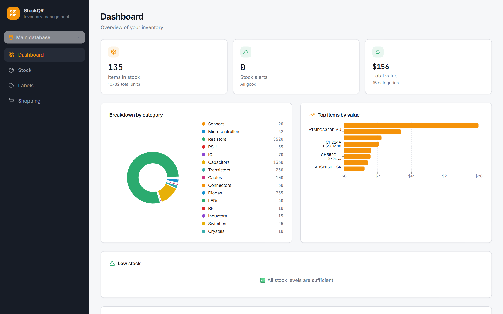
</picture>

</div>

---

## Contents

- [Features](#features)
- [Screenshots](#screenshots)
- [Labels for the Brother PT-P700](#labels-for-the-brother-pt-p700)
- [Getting started](#getting-started)
- [Self-hosting on a NAS](#self-hosting-on-a-nas)
- [Importing LCSC orders](#importing-lcsc-orders)
- [Data that never changes](#data-that-never-changes)
- [Project structure](#project-structure)
- [Scripts](#scripts)
- [Troubleshooting](#troubleshooting)

## Features

| | |
|---|---|
| 📦 **Stock** | Every part with image, value, package, quantity, minimum level, location and price. Search by name, SKU, LCSC number or supplier; filter by category, manufacturer and package. |
| 🔎 **LCSC lookup** | Type an LCSC number (`C17673`) and the image, datasheet, manufacturer, MPN, package and full specs are fetched automatically. |
| 📥 **Order import** | Drop the CSV exported from your LCSC order history: new parts are created with their specs, parts already in stock get their quantity increased. |
| 🗂️ **Categories** | Resistors, Capacitors, Inductors, Diodes, Transistors, LEDs, PSU, ICs, Microcontrollers, Connectors, Switches, Crystals, Sensors, RF, Cables, detected from the LCSC data. |
| 🏷️ **Labels** | Direct printing to a Brother PT-P700 with no driver involved: exact 180 dpi bitmaps, Data Matrix or QR codes, ESD box mode, custom layouts. |
| 📷 **Scanner** | Scan a label with the phone camera to open the part. Reads Data Matrix and QR. |
| 📊 **Dashboard** | Items, units, total value, breakdown by category, most valuable parts, low stock alerts. |
| 🛒 **Shopping lists** | Collect what to reorder, straight from a part page. |
| 🌗 **Light and dark** | Follows the system theme, with a toggle. |

## Screenshots

<table>
  <tr>
    <td width="50%">
      <picture>
        <source media="(prefers-color-scheme: dark)" srcset="docs/images/stock-dark.png" />
        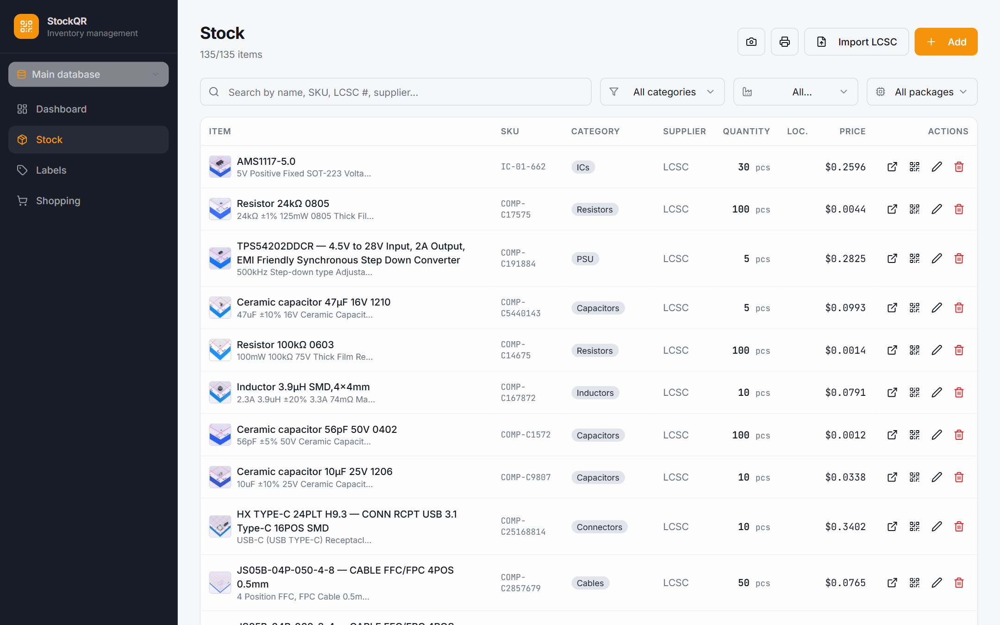
      </picture>
      <p align="center"><b>Stock</b>: search, filters and quick actions</p>
    </td>
    <td width="50%">
      <picture>
        <source media="(prefers-color-scheme: dark)" srcset="docs/images/item-dark.png" />
        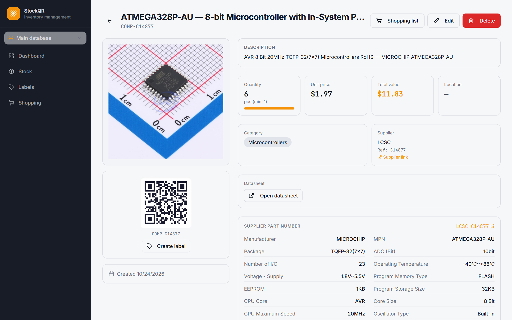
      </picture>
      <p align="center"><b>Part page</b>: LCSC specs, datasheet, stock value</p>
    </td>
  </tr>
  <tr>
    <td width="50%">
      <picture>
        <source media="(prefers-color-scheme: dark)" srcset="docs/images/import-dark.png" />
        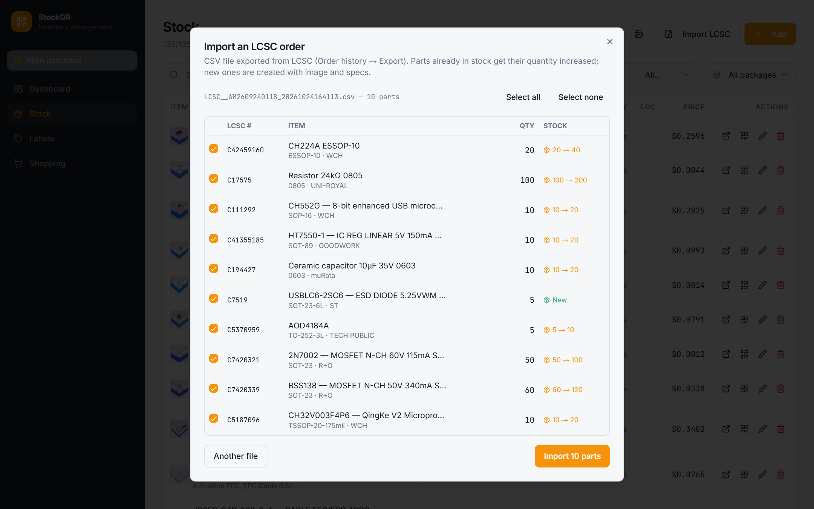
      </picture>
      <p align="center"><b>LCSC import</b>: new parts and stock updates at a glance</p>
    </td>
    <td width="50%">
      <picture>
        <source media="(prefers-color-scheme: dark)" srcset="docs/images/edit-dark.png" />
        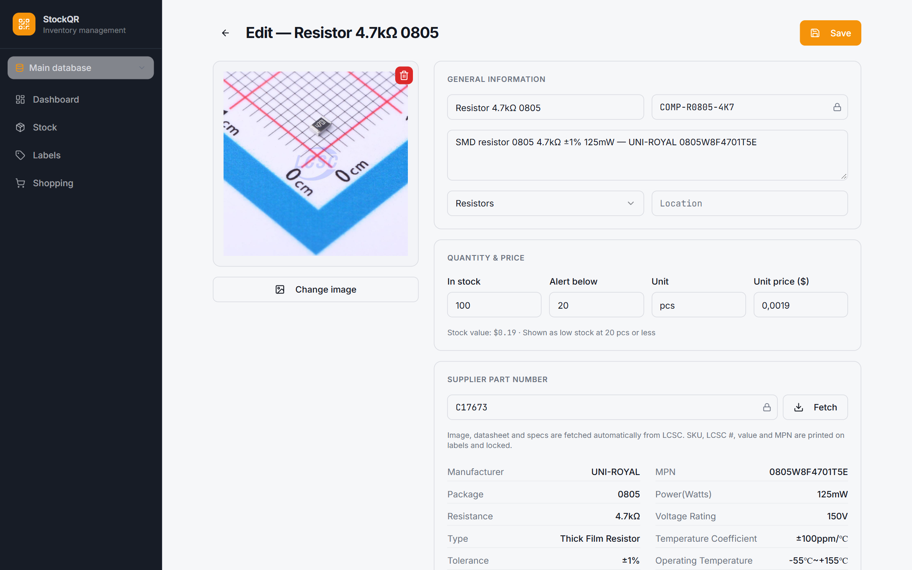
      </picture>
      <p align="center"><b>Edit</b>: fields printed on labels are locked</p>
    </td>
  </tr>
</table>

## Labels for the Brother PT-P700

<picture>
  <source media="(prefers-color-scheme: dark)" srcset="docs/images/labels-dark.png" />
  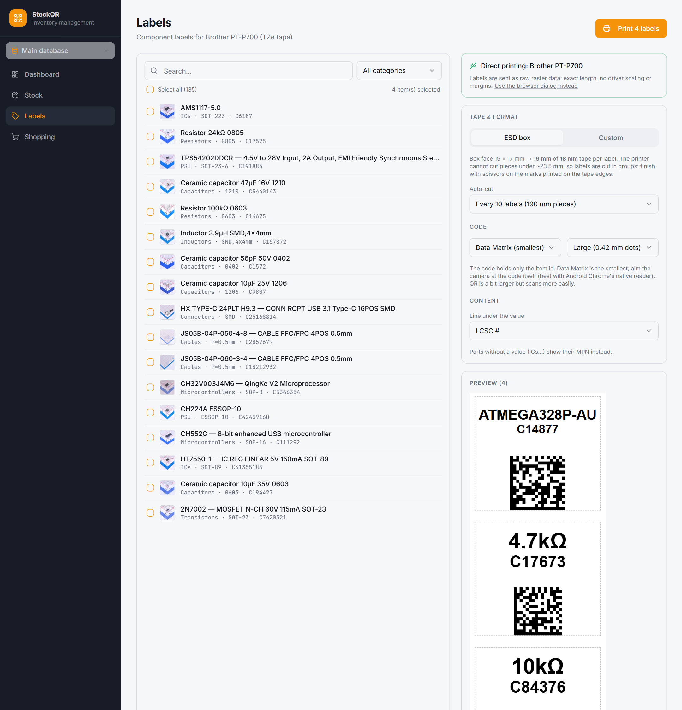
</picture>

### ESD box mode

Made for a 19 × 17 mm box face on **18 mm TZe tape**: the value in large type, the LCSC number (or your SKU) right below it, and a Data Matrix that opens the part when scanned. Parts without a value, like ICs, show their MPN instead.

<p align="center">
  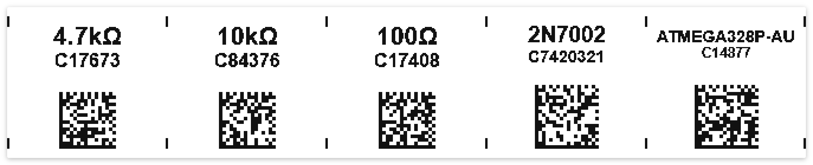
</p>

> [!NOTE]
> The PT-P700 cannot cut a piece shorter than about 23.5 mm (the distance between the print head and the cutter). Labels of 19 mm are therefore printed as a strip and **auto-cut every 10 labels**; the small marks on the tape edges show where to finish with scissors. The interval can be changed (2, 3, 4, 5 or 10 labels, or one single strip).

### Custom mode

Any tape width (6 to 24 mm) and length. Choose the code (Data Matrix, QR or none), where it goes (auto, left, right, top, bottom), which lines to print and in which order. Text is centred and shrunk to fit, measured on the real font.

<p align="center">
  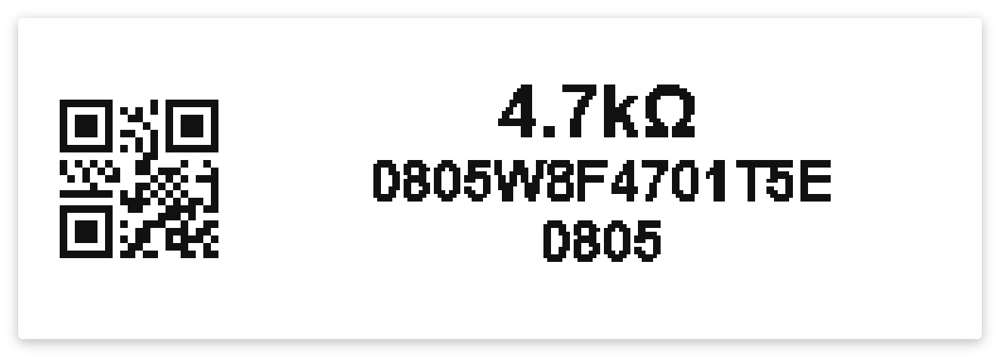
  &nbsp;&nbsp;
  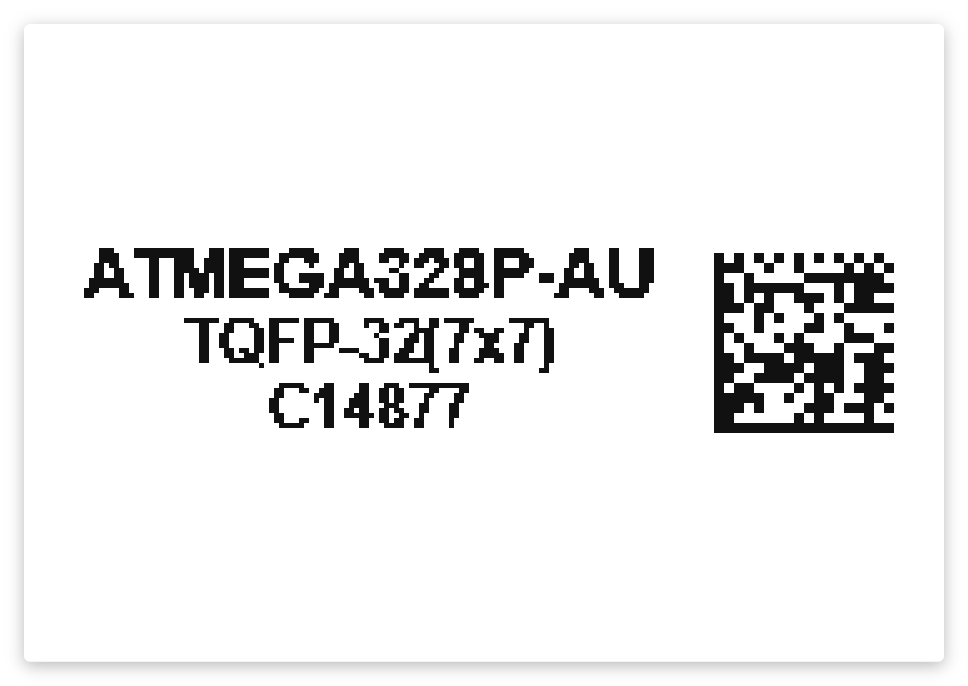
</p>

### How printing works

The Brother Windows driver scales and pads labels, so StockQR bypasses it. The page draws each label at the exact resolution of the print head, encodes it as Brother raster commands, and a tiny local relay sends those bytes untouched to the print queue.

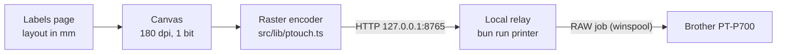

- **Exact size**: 128-pin head at 180 dpi, codes printed with a whole number of dots per module so they stay sharp.
- **Calibration**: tape margin, print height, start offset and vertical offset, saved in the browser.
- **Fallback**: if the relay is not running, labels can still go through the browser print dialog.

> [!TIP]
> Data Matrix is the most compact code. When scanning, aim the camera at the code itself rather than at the whole label; Android Chrome's native barcode reader is used when available.

## Getting started

### Requirements

- [Bun](https://bun.sh) (or Node.js 18+ with npm)
- A free [Supabase](https://supabase.com) project
- For printing: Windows, a Brother PT-P700 on USB with its driver installed (the queue is used in RAW mode), and **Editor Lite turned off** (the EL light must be off)

### 1. Install

```sh
git clone https://github.com/cocoxis/qr-stock-craft.git
cd qr-stock-craft
bun install
```

### 2. Database

1. In Supabase, open **SQL Editor**, paste [`supabase/setup.sql`](supabase/setup.sql) and run it. It creates the tables, policies and grants, and can be run again safely. To start with sample parts, also run [`supabase/seed_e12_resistors.sql`](supabase/seed_e12_resistors.sql) (E12 0805 resistors).
2. Optional but recommended once you print labels: run [`supabase/migrations/20261024180000_lock_label_fields.sql`](supabase/migrations/20261024180000_lock_label_fields.sql) to lock the printed fields (see [below](#data-that-never-changes)).
3. Deploy the LCSC lookup function (it proxies the LCSC API, which does not allow browser requests):

   ```sh
   bunx supabase login
   bunx supabase functions deploy lcsc --project-ref <your-project-ref> --no-verify-jwt
   ```

### 3. Configure

Create `.env` at the project root with your project URL and publishable key (Supabase → Project Settings → API):

```env
VITE_SUPABASE_URL="https://<your-project-ref>.supabase.co"
VITE_SUPABASE_PUBLISHABLE_KEY="sb_publishable_..."
VITE_SUPABASE_PROJECT_ID="<your-project-ref>"
```

> [!WARNING]
> Only the publishable key belongs in `.env`. Never commit a personal access token or the service role key; files ending in `.local` are ignored by git for that purpose.

### 4. Run

```sh
bun run dev        # app on http://localhost:8080
bun run printer    # label relay on http://127.0.0.1:8765 (keep the window open)
```

The Labels page shows **Direct printing: Brother PT-P700** in green once the relay finds the printer. To use another queue name: `PTOUCH_PRINTER="My printer" bun run printer`.

## Self-hosting on a NAS

StockQR also runs entirely on your own server with Docker: Postgres, PostgREST and the app image built by GitHub Actions (`ghcr.io/cocoxis/qr-stock-craft`). The Supabase project then becomes a backup: on first start an empty database is filled from it, and every few hours the NAS data is copied back to it, along with a JSON backup file on the NAS.

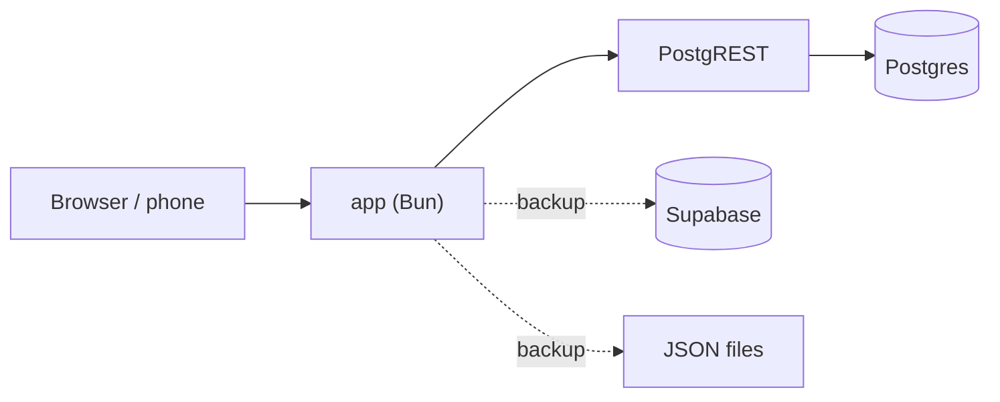

Step-by-step Unraid guide (one script, no Compose needed): [`deploy/README.md`](deploy/README.md).

## Importing LCSC orders

1. On lcsc.com, open **Order history**, pick an order and **Export** it as CSV.
2. In StockQR, go to **Stock → Import LCSC** and drop the file.
3. Check the list: each line shows whether the part is **New** or how its stock will change (`100 → 200`). Untick what you do not want, then **Import**.

Parts ordered several times are merged by LCSC number, and package names from different vendors are normalised (`SOT-23-6L` = `SOT-23-6`).

## Data that never changes

Once a label is printed, what it shows must stay true. The database refuses any change to:

| Field | Why |
|---|---|
| Item id | It is what the Data Matrix / QR code contains |
| SKU | Can be printed on the label |
| LCSC number | Printed under the value |
| Value | Printed in large type |
| MPN | Printed for parts without a value |

Quantity, location, price, image and description stay editable. The edit form shows the locked fields with a padlock.

To correct a real mistake, use the Supabase SQL Editor:

```sql
begin;
set local app.unlock_labels = 'on';
update stock_items set component_value = '4.7kΩ' where id = 'stk-r0805-4K7';
commit;
```

## Project structure

```text
src/
├── pages/                  Dashboard, Stock, part details/edit, Labels, Shopping
├── components/             Layout, scanner, LCSC import dialog, shadcn/ui
├── hooks/                  React Query hooks (stock, shopping lists)
└── lib/
    ├── labelLayout.ts      Label layout (mm) and 180 dpi bitmap rendering
    ├── ptouch.ts           Brother raster encoder and relay client
    ├── qr.ts               Data Matrix / QR generation, scanned code parsing
    ├── lcsc.ts             LCSC part lookup
    ├── lcscOrder.ts        LCSC CSV parser and part builder
    └── categories.ts       Category detection rules
scripts/
├── ptouch-relay.ts         Local print relay (Bun)
└── raw-print.ps1           Sends a file RAW to a Windows print queue
server/
├── index.ts                Self-hosted server: app, API proxy, LCSC lookup
└── backup.ts               Backup files, Supabase mirror and first-start restore
deploy/                     Docker Compose stack for a NAS (Unraid)
supabase/
├── setup.sql               Full database setup for a new project
├── migrations/             Schema history
├── seed_e12_resistors.sql  Optional sample parts
└── functions/lcsc/         Edge Function proxying the LCSC API
```

## Scripts

| Command | What it does |
|---|---|
| `bun run dev` | Development server on port 8080 |
| `bun run printer` | Local relay for direct label printing |
| `bun run build` | Production build in `dist/` |
| `bun run preview` | Serve the production build |
| `bun run lint` | ESLint |
| `bun run test` | Vitest |

## Troubleshooting

<details>
<summary><b>The Labels page says the relay is not running</b></summary>

Start it with `bun run printer` and keep that terminal open. The page checks every 5 seconds.
</details>

<details>
<summary><b>Nothing prints, or the printer shows up as a USB drive</b></summary>

Editor Lite is on. Press and hold the Editor Lite button until the EL light turns off.
</details>

<details>
<summary><b>The printer rejects the job</b></summary>

The tape width is part of the job. Make sure the cassette in the printer matches the tape selected on the Labels page (18 mm for ESD box mode).
</details>

<details>
<summary><b>A single label comes out longer than expected</b></summary>

That is the cutter's minimum length (about 23.5 mm). Print several labels at once and cut on the marks.
</details>

<details>
<summary><b>Text or code is cut on an edge</b></summary>

Use <b>Printer calibration</b> on the Labels page: lower <i>Print height</i> or adjust <i>Vertical offset</i>; raise <i>Start offset</i> if the start of the label is cut.
</details>

<details>
<summary><b>LCSC numbers do not fetch anything</b></summary>

The <code>lcsc</code> Edge Function is not deployed, or was deployed with JWT verification. Deploy it again with <code>--no-verify-jwt</code>.
</details>
