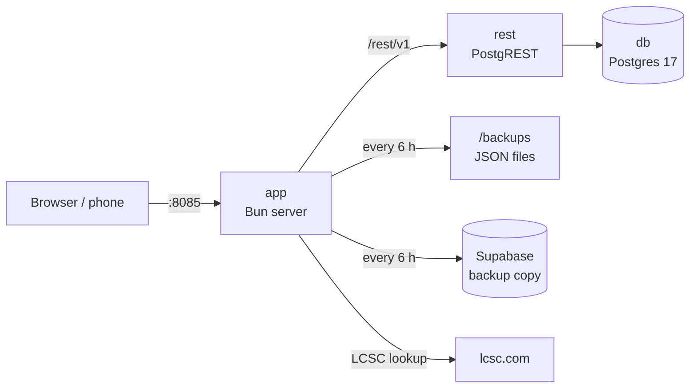

# Self-hosting StockQR (Unraid / Docker)

Three containers: **Postgres** (the data), **PostgREST** (the same REST API as Supabase) and the **StockQR app** (web app, LCSC lookup, backups). The app image is built by GitHub Actions on every push to `main`: `ghcr.io/cocoxis/qr-stock-craft:latest`.



## Install on Unraid

1. Install **Docker Compose Manager** from Community Applications.
2. **Docker** tab → **Add New Stack** → name it `stockqr`.
3. Edit the stack:
   - **Compose file**: paste [`docker-compose.yml`](docker-compose.yml).
   - **Env file**: paste [`.env.example`](.env.example) and fill it in:
     - `DB_PASSWORD`: a long password, letters and digits only.
     - `BACKUP_SUPABASE_URL` and `BACKUP_SUPABASE_KEY`: your Supabase project URL and publishable key (Project Settings → API).
4. **Compose Up**.
5. Open `http://<nas>:8085`.

On the first start the database is empty, so StockQR copies everything from the Supabase project. Watch it in the `app` container logs:

```text
Database schema ready
StockQR listening on :8080
[backup] Local database is empty: restoring from Supabase…
[backup]   stock_items: 135 rows restored
[backup] OK Saved 135 items to stockqr-….json and Supabase.
```

## Backups

Every `BACKUP_INTERVAL_HOURS` (6 by default) and at each start:

- a JSON file with all tables is written to `APPDATA/backups` (the last `BACKUP_KEEP` are kept);
- the Supabase project is updated to match the NAS: new and changed rows are copied, deleted rows are removed.

Safety: the Supabase copy is never wiped by an empty or half-empty NAS database. The mirror is skipped when the NAS has no parts, or less than half of what Supabase has, and it is disabled if the first-start restore failed.

Settings → **Backups** shows the last backup and has a **Back up now** button.

## Update

The image is rebuilt by GitHub on every push. In Unraid: stack → **Update Stack** (or `docker compose pull && docker compose up -d`). The database schema is updated automatically at start.

## Restore

- **From Supabase**: stop the stack, delete `APPDATA/db`, start again. The empty database is filled from Supabase.
- **From a backup file**: each file holds `{ "tables": { "stock_items": [...], ... } }`, rows in the same format as the API.

## Label printing

Printing still goes through the relay on the Windows PC the printer is plugged into (`bun run printer`). The browser calls it on `127.0.0.1`, so it works the same whether the app comes from `localhost` or from the NAS.

## Environment variables (app container)

| Variable | Default | |
|---|---|---|
| `DATABASE_URL` | | Postgres owner connection, used to create and update the schema |
| `AUTHENTICATOR_PASSWORD` | | Password given to the `authenticator` role that PostgREST uses |
| `POSTGREST_URL` | `http://rest:3000` | PostgREST inside the stack |
| `BACKUP_SUPABASE_URL` / `BACKUP_SUPABASE_KEY` | | Supabase project used as backup and first-start source |
| `BACKUP_INTERVAL_HOURS` | `6` | `0` disables scheduled backups |
| `BACKUP_KEEP` | `30` | Backup files kept |
| `BACKUP_DIR` | `/backups` | |
| `PORT` | `8080` | Port inside the container |
